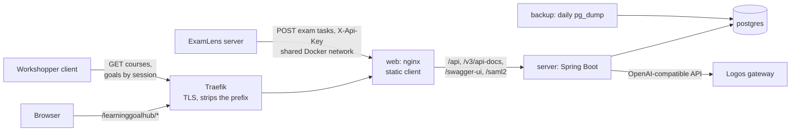
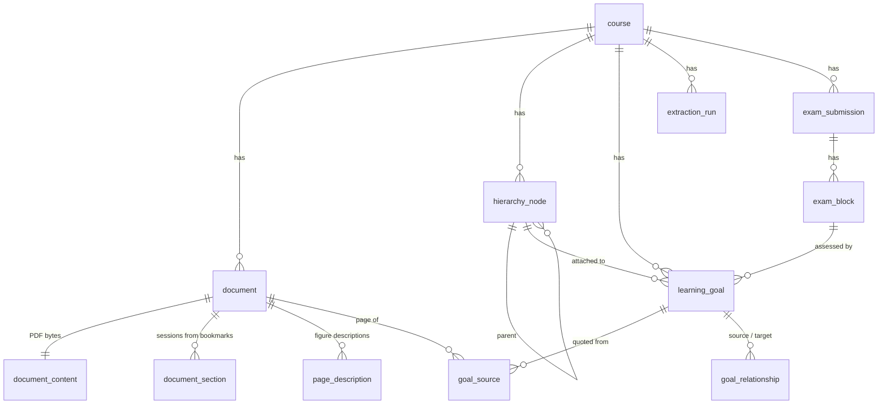

# Architecture

How LearningGoalHub's parts fit together at runtime and what the database holds. The server's
packages and the steps of an extraction run are in [server/README.md](../server/README.md);
deployment is in [DEPLOY.md](../DEPLOY.md).

## Runtime

- **web** serves the built React client and proxies the API, the OpenAPI document, Swagger UI
  and the SAML endpoints to the server. It sets the security headers (see
  [SECURITY.md](SECURITY.md#output)).
- **server** holds all logic. Extraction runs on a background thread after
  `POST /extract` returns `202`; the client polls `/extract/status` for progress.
- **postgres** has no host port. Flyway migrates it when the server starts.
- **Logos** is the only external service the server calls. Every call is listed in
  [LLM.md](LLM.md).
- **ExamLens and Workshopper** use the API described in [api.md](api.md).

The four containers are defined in `compose.prod.yaml`; locally only Postgres runs in Docker and
the server and client run on the host (see the [README](../README.md#run-locally)).

## Client

React 18 with React Router (two pages: the course list and a course), TanStack Query for server
state, and `openapi-fetch` with types generated from the server's OpenAPI document. Once the
types are regenerated, a changed response shape fails `npm run typecheck`. The source pane renders the PDF with pdf.js and draws
the highlight rectangles the server computed. Details in [client/README.md](../client/README.md).

## Data model

Deleting a course deletes everything below it (`ON DELETE CASCADE`).

**Hierarchy nodes** say where a goal comes from. A course has a `MODULE` root with one `SESSION`
per lecture session and one `EXERCISE` per exercise sheet, an `EXAM` root for ExamLens goals, and
a `COMPETENCY` root that holds the Topic tree's topics.

**Learning goals** carry the text, an `origin`, a `role`, Bloom and SOLO levels, a review
`status` (`PENDING`, `APPROVED`) and, for goals made in the UI, a `creation_provenance`
(`USER_CREATED`, `WIZARD_AI_SUBTREE`).

| `origin` | Meaning | Source quote |
| --- | --- | --- |
| `EXTRACTED` | read from a document by the extraction | yes |
| `SYNTHESIZED` | a Skill that groups sub-skills, made by the Topic tree or "Find in the slides" | no |
| `TERMINAL` | a topic, the root of a Topic tree branch | no |
| `EXAM` | derived from an ExamLens exam task | no, the task text |

**Relationships** are `CONTRIBUTES_TO` edges from a goal to the goal above it, and the Topic tree
is nothing but these edges. Their `origin` tells who made them: `HIERARCHY` for knowledge under
its sub-skill (extraction, "Find in the slides", edits) and `SYNTHESIS` for edges the Topic tree
build lays. A rebuild deletes and recreates only the `SYNTHESIS` edges. How the tiers appear in
the API is in [api.md](api.md#topic-tree).

**Goal sources** hold the quoted snippet, its page, how exactly it was found in the text
(`grounding_quality`), whether it came from text or a figure description (`evidence_kind`), and
the highlight rectangles on the page. When the server cannot find a quote in the document, it
leaves `snippet` empty and keeps the model's text in `unverified_snippet`.

**Extraction runs** record each run's model, prompt version, parameters, status, goal count,
failed sessions and dropped outcomes (see [LLM.md](LLM.md#comparing-runs)).

### Legacy values

Older prototypes wrote values that nothing produces any more. They stay in the enums because a
database with evaluation data still holds them. The client filters out `GAP` goals.

| Column | Legacy values |
| --- | --- |
| `learning_goal.origin` | `GAP` (goals from a removed gap analysis) |
| `goal_relationship.type` | `SUPPORTS`, `PREREQUISITE_OF`, `OVERLAPS_WITH` |
| `goal_relationship.origin` | `EMBEDDING`, `LLM` |

The `embedding` column, and with it the `pgvector` image, belongs to the same history (migration
`V6` creates the extension).
